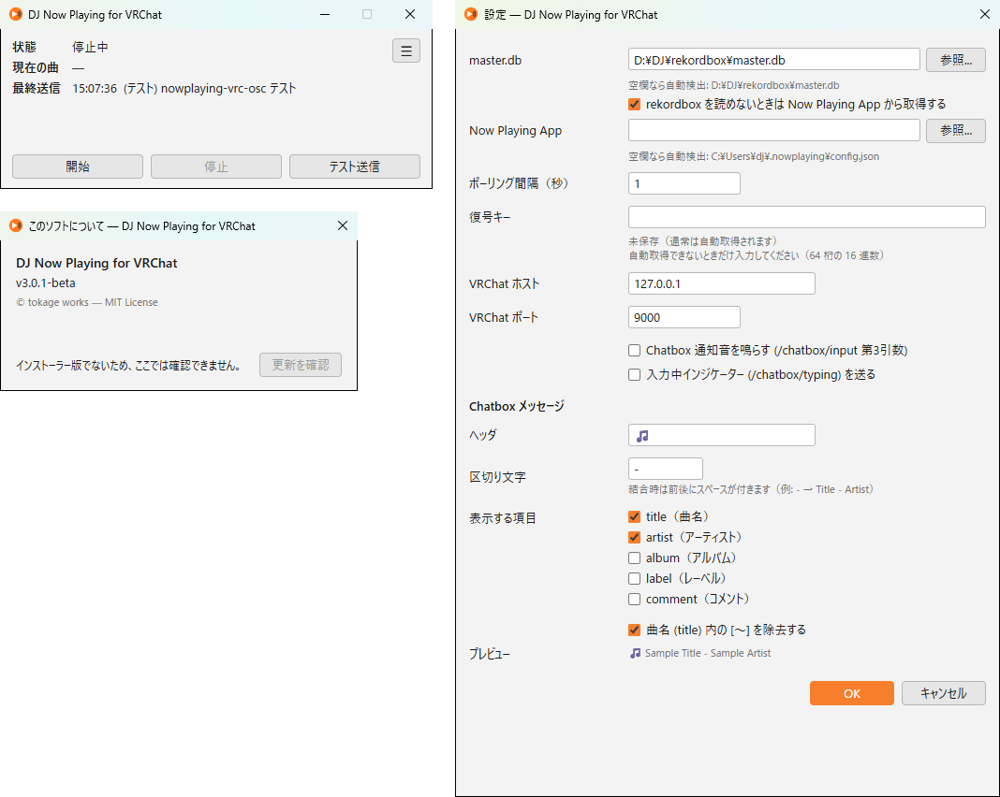

# DJ Now Playing for VRChat

rekordbox で再生した曲を、VRChat の Chatbox に `🎵 Title - Artist` の形で表示する Windows アプリです。
rekordbox のデータベース（`master.db`）を読み取り専用で直接読み、OSC で VRChat に送ります。
rekordbox を直接読めないときは、[Now Playing App 2](https://nowplayingapp.com) が取得した曲を送ります。Serato や Traktor など、rekordbox 以外の DJ ソフトでも使えます。画面は日本語です。

> rekordbox（AlphaTheta）、Now Playing App（Triode）、VRChat、Spotify の公式ツールではありません。自己責任でご利用ください。
> 趣味で作っています。要望に応えられるとは限りません。不具合は [Issues](https://github.com/khlizard/nowplaying-vrc-osc/issues) で知らせてください。

## 必要なもの

- Windows 10 / 11（64bit）
- rekordbox 7、または Now Playing App 2（rekordbox 以外の DJ ソフトで使うとき）
- VRChat（OSC を有効にしておく）
- Microsoft Edge WebView2 ランタイム（Windows 11 は標準搭載。インストーラー版は、無ければ自動で入れます）

## 入手

| 形式 | 入手先 | 自動更新 |
|---|---|---|
| インストーラー（`NowPlayingVrcOsc-win-Setup.exe`） | [GitHub Releases](https://github.com/khlizard/nowplaying-vrc-osc/releases) | あり |
| ZIP | [BOOTH](https://tokageworks.booth.pm/) | なし |

インストーラー版は `%LocalAppData%\NowPlayingVrcOsc` に入ります。管理者権限は要りません。
コード署名をしていないため、初回起動時に SmartScreen の警告が出ることがあります。「詳細情報」→「実行」で起動できます。

## 使い方

1. VRChat でアクションメニュー → **Osc** → **Enabled** をオンにする。
2. rekordbox を起動する。
3. アプリを起動して **［開始］** を押す。
4. rekordbox が履歴に曲を記録すると、Chatbox に送られる。

- アプリを起動した時点で再生中の曲は送りません。
- rekordbox は「再生時間設定」（環境設定 > 詳細 > ブラウズ）の秒数だけ再生してから履歴に記録します。送信はその分遅れます。
- 同じ曲が続けて記録されたときは送り直しません。
- **［テスト送信］** で、VRChat に届くかを確認できます。
- 最小化するとトレイに入り、監視は続きます。× で閉じるとアプリが終了します。
- 多重起動はできません。2 つ目を起動すると、起動中のウィンドウが前に出ます。
- 右上の **☰** から、設定と「このソフトについて」（バージョンの確認と更新の確認）を開けます。

### Now Playing App から取得する

rekordbox を直接読めないとき（起動していない、`master.db` が無い、復号キーを取得できない、など）は、Now Playing App 2 が取得した曲を送ります。状態欄には「Now Playing App から取得しています」と出ます。

- Now Playing App の `config.json`（既定は `%USERPROFILE%\.nowplaying\config.json`）から、再生中の曲を読みます。Now Playing App が曲を切り替えたときに送ります。
- 切り替えた時点で再生中の曲は送りません。
- rekordbox を読めるようになったら、rekordbox に戻ります。
- 設定で取得しないようにもできます。

### Spotify の曲

rekordbox 上の Spotify の曲は、曲名が暗号化されています。
このときは曲名だけを Spotify から取得して送ります。アーティストは送りません。

## 設定

**☰ →［設定...］** で次の項目を変えられます。

- `master.db` の場所（空欄なら自動で探します）
- rekordbox を読めないときに Now Playing App から取得するか（既定はオン）と、`config.json` の場所（空欄なら `%USERPROFILE%\.nowplaying\config.json`）
- 復号キー（自動で取得できないときだけ入力します）
- 確認の間隔、OSC の送信先（既定 `127.0.0.1:9000`）、通知音、入力中インジケーター
- Chatbox の文面: ヘッダ、区切り文字、表示する項目（曲名・アーティスト・アルバム・レーベル・コメント）、曲名の `[～]` を除くか

設定は `%AppData%\NowPlayingVrcOsc\settings.json` に保存されます。

## 通信とデータの扱い

- `master.db` には書き込みません。
- Now Playing App の `config.json` は読むだけです。再生中の曲（`currentTrack`）のほかは読みません。
- `master.db` の復号キーは、公開されている情報から自動で取得します（GitHub への通信があります）。取得したキーは Windows の DPAPI で暗号化して `%AppData%\NowPlayingVrcOsc\key.dpapi` に保存します。
- Spotify の曲名を取得するときは、Spotify にトラック ID を送ります。
- インストーラー版は、起動時と、「このソフトについて」で［更新を確認］を押したときに、GitHub Releases で新しい版を確認します。
- インストーラー版をアンインストールすると、設定と復号キーも削除します。ZIP 版をやめるときは `%AppData%\NowPlayingVrcOsc` を手で削除してください。

## うまく動かないとき

| 状態欄の表示・症状 | 確認すること |
|---|---|
| 「rekordbox の起動を待っています」 | rekordbox を起動する。rekordbox 以外の DJ ソフトなら、Now Playing App 2 を起動する |
| 「Now Playing App から取得しています」なのに送られない | Now Playing App が曲を取得しているか。切り替えた時点の曲は送らない |
| 「master.db が見つかりません」 | ☰ →［設定...］で `master.db` の場所を指定する |
| 「復号キーを取得できません」 | インターネット接続を確認する。または ☰ →［設定...］の「復号キー」に入力する |
| 「曲名を取得できませんでした（Spotify）」 | Spotify から曲名を取得できなかった。その曲は送らない |
| 曲が送られない | 再生時間設定の秒数より長く再生したか。rekordbox の履歴に記録されているか |
| VRChat に表示されない | OSC が有効か。［テスト送信］を試す |

## 既知の制限

- 送信は、rekordbox の「再生時間設定」の秒数だけ遅れます。
- rekordbox の履歴にはデッキの情報がありません。最後に記録された曲を送ります。
- Spotify の曲は、アーティストを送りません。
- VRChat の Chatbox は 144 文字までです。アプリでは切り詰めません。

## ソースからビルドする

ビルド、テスト、配布物の作り方は [`app/README.md`](app/README.md) を参照してください。
仕組みの説明は [`docs/design.ja.md`](docs/design.ja.md) にあります。

## 変更履歴

[`CHANGELOG.md`](CHANGELOG.md) を参照してください。

## ライセンス

[MIT License](LICENSE)（Copyright © 2026 tokage works）
使用しているライブラリのライセンスは [`release/THIRD-PARTY-NOTICES.txt`](release/THIRD-PARTY-NOTICES.txt) にあります。
