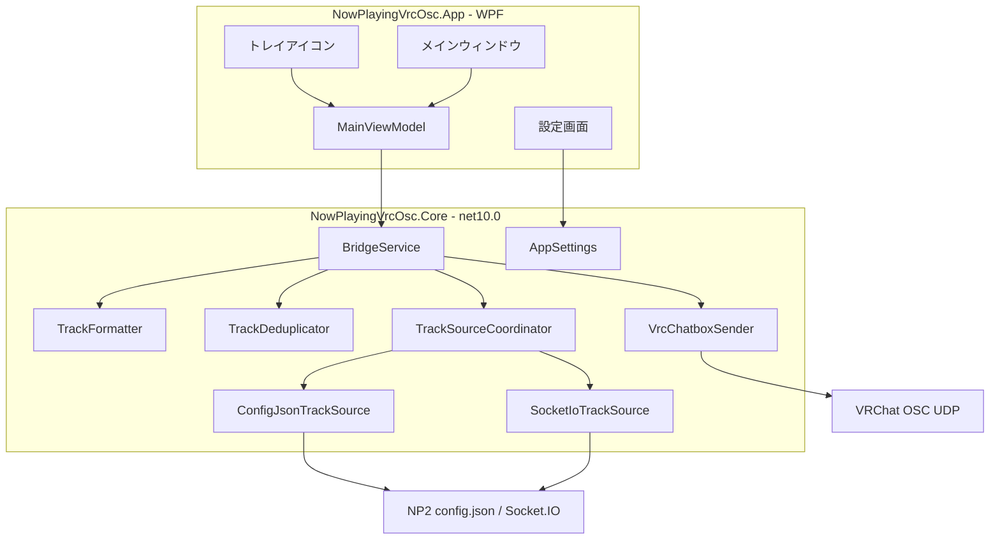

# nowplaying-vrc-osc — C# Windows GUI 版 開発計画

本ドキュメントは、Python CLI 版 [`nowplaying-vrc-osc.py`](../../nowplaying-vrc-osc.py) をベースに **C# / .NET 10 / WPF** で Windows GUI 版を作るための計画書です。別スレッド・別セッションで開発を再開するときの参照用に、ここまでの合意・仕様・進め方を一括でまとめています。

---

## 1. 背景と目的

### 背景

- **Now Playing App 2（NP2）** から曲情報を取得し、**VRChat Chatbox** へ OSC（`/chatbox/input`）で送る非公式ブリッジ
- Python CLI 版（`nowplaying-vrc-osc.py`）は **v1 完成** として一旦区切り
- 次のステップとして **Windows 常駐 GUI 版** を C# で作りたい

### GUI 版の目的

| 項目 | CLI 版 | GUI 版 |
|---|---|---|
| 実行 | ターミナル常駐 | トレイ常駐 + 設定画面 |
| 設定 | `.env` / CLI 引数 | GUI + `settings.json` |
| 依存 | Python + pip | .NET 10 単体 exe 配布可 |
| 状態確認 | コンソール出力 | 画面・ログで可視化 |

Python 版は **残す**（仕様の参照実装・軽量利用向け）。C# 版は **GUI・配布向け**。

---

## 2. Python 版 v1 ベースライン（移植元仕様）

移植時は [`nowplaying-vrc-osc.py`](../../nowplaying-vrc-osc.py) および [`.env.example`](../../.env.example) を **正** とする。

### 2.1 データフロー

```
Now Playing App 2
 ├── config.json (currentTrack)  ── poll（既定）──┐
 └── Socket.IO :<ポート>  ── fallback ──────────┤
                                                 ▼
                                    nowplaying-vrc-osc
                                                 │
                                                 ▼  OSC /chatbox/input
                                    VRChat (UDP :9000)
```

### 2.2 曲情報の取得方式

| 方式 | 説明 | 優先度 |
|---|---|---|
| **config.json 監視（既定）** | `%USERPROFILE%\.nowplaying\config.json` の `currentTrack` を mtime ポーリング | 主経路 |
| **Socket.IO（フォールバック）** | config が無い／読めない場合。`trackUpdate` / `animate` | 副経路 |
| **auto** | config 優先 → 失敗時 Socket.IO | CLI/GUI 既定 |

詳細: `refs/now-playing-app/external-connection.ja.md`（ローカル参照用。リポジトリには含めない）

#### config.json 監視の要点

- 既定パス: `%USERPROFILE%\.nowplaying\config.json`
- ポーリング間隔: **0.5 秒**（mtime 変化時に JSON 読込）
- 書き込み途中の JSON はパース失敗 → **静かにスキップ**して次回再試行
- `localSocketPort` から Socket.IO URL を自動検出（例: `http://localhost:29000`）
- **watchdog は使わない**（ポーリングで十分。依存を増やさない）

#### Socket.IO の要点

- Socket.IO **4.x** クライアント必須（生 WebSocket 不可）
- 接続後: `emit('id', 'NowPlayingTrackReceivers')`
- イベント: `trackUpdate`, `animate` → `data.args[0]` がトラック
- **起動時の `getCurrentTrack` は呼ばない**（起動時曲を送らないため）

### 2.3 曲変更の検知・送信ルール

| ルール | 実装 |
|---|---|
| 重複抑制 | `currentTrack.id` を優先（無い場合は `title`） |
| **起動時の現在曲** | **表示・送信しない**（初回は baseline 記録のみ） |
| 2 曲目以降 | 曲が変わったタイミングで送信 |

### 2.4 表示フォーマット（`format_track`）

| 項目 | 仕様 |
|---|---|
| 順序 | **`Title - Artist`**（曲名が先） |
| アーティスト不明 | 空 / `None` / `unknown` / `n/a` / `?` → **非表示**（曲名のみ） |
| レーベル（`label` フィールド） | **`NP_SHOW_LABEL=true` のときのみ** `[Label]` を末尾に付与（既定: 非表示） |
| 曲名内 `[～]` | **`NP_STRIP_TITLE_BRACKETS=true` のとき除去**（既定: 除去） |

**変換例**

| title | artist | 出力 |
|---|---|---|
| `LIFE (feat. bird) [Tokage Extend Edit]` | `MONDO GROSSO` | `LIFE (feat. bird) - MONDO GROSSO` |
| `LIFE (feat. bird) [Tokage Extend Edit]` | `MONDO GROSSO`（brackets 除去 off） | `LIFE (feat. bird) [Tokage Extend Edit] - MONDO GROSSO` |
| `Some Song` | `None` | `Some Song` |

**Chatbox 送信テキスト（意図した形式）**

```
🎵 {format_track の結果}
```

### 2.5 VRChat OSC 送信

| アドレス | 内容 |
|---|---|
| `/chatbox/input` | `[text, true, notification]` — 即時送信、第3引数=通知 SE |
| `/chatbox/typing` | インジケーター ON/OFF（送信前後、`indicator=true` 時のみ） |

詳細: `refs/vrc_osc_ja/osc-as-input-controller.md`（ローカル参照用）、公式: https://docs.vrchat.com/docs/osc-as-input-controller

### 2.6 設定一覧（Python 版 `.env` = GUI 版で移植）

| 環境変数（Python） | 既定値 | GUI 設定名（案） | 説明 |
|---|---|---|---|
| `NP_SOURCE` | `auto` | `Source` | `auto` / `config` / `socketio` |
| `NP_CONFIG_PATH` | `~/.nowplaying/config.json` | `ConfigPath` | NP2 config.json |
| `NP_POLL_INTERVAL` | `0.5` | `PollIntervalSeconds` | ポーリング間隔 |
| `NP_URL` | 自動 → `9000` | `NpUrl` | Socket.IO URL |
| `VRC_OSC_HOST` | `127.0.0.1` | `VrcHost` | OSC 送信先 |
| `VRC_OSC_PORT` | `9000` | `VrcPort` | OSC ポート |
| `VRC_CHATBOX_NOTIFICATION` | `false` | `ChatboxNotification` | 通知音 |
| `VRC_CHATBOX_INDICATOR` | `false` | `ChatboxIndicator` | typing インジケーター |
| `NP_SHOW_LABEL` | `false` | `ShowLabel` | label フィールド表示 |
| `NP_STRIP_TITLE_BRACKETS` | `true` | `StripTitleBrackets` | title 内 `[～]` 除去 |

GUI 版の設定保存先（案）: `%AppData%\NowPlayingVrcOsc\settings.json`

### 2.7 CLI テストモード（GUI でも相当機能を用意）

| Python オプション | GUI 相当（案） |
|---|---|
| `--receive-only` | 「受信テスト」モード（OSC 送信しない） |
| `--send-only` | 「テスト送信」ボタン |
| `--help` | 設定画面・README リンク |

---

## 3. C# GUI 版 — 技術選定

### 3.1 .NET 10（LTS）

| 項目 | 選定 |
|---|---|
| Core | **`net10.0`** |
| WPF App | **`net10.0-windows`** |
| IDE | Visual Studio 2026 推奨 |
| 配布 | `win-x64` 単一 exe（`PublishSingleFile`） |

.NET 10 は 2025年11月 GA、LTS（〜2028年頃）。常駐ツール向け。

### 3.2 UI フレームワーク

**WPF** を推奨（WinUI 3 よりトレイ常駐・設定画面が作りやすい）。

パターン: **MVVM**（ViewModel + バックグラウンド `BridgeService`）

### 3.3 NuGet（案）

| 用途 | パッケージ |
|---|---|
| OSC 送信 | `OscCore` 等 |
| Socket.IO（Phase 4） | `SocketIOClient` |
| JSON | `System.Text.Json`（標準） |

---

## 4. アーキテクチャ



### 4.1 Core モジュール分割（案）

| クラス / インターフェース | 責務 |
|---|---|
| `TrackInfo` | `id`, `title`, `artist`, `label` 等 |
| `TrackFormatter` | 表示文字列生成（Python `format_track` 相当） |
| `TrackDeduplicator` | id ベース重複抑制 + 起動時スキップ |
| `ITrackSource` | 曲変更イベントの抽象 |
| `ConfigJsonTrackSource` | config.json ポーリング |
| `SocketIoTrackSource` | Socket.IO 接続 |
| `TrackSourceCoordinator` | auto / config / socketio 切替 |
| `VrcChatboxSender` | OSC 送信 |
| `BridgeService` | Start / Stop、曲変更 → フォーマット → 送信 |
| `AppSettings` | 設定の load / save |

### 4.2 スレッドモデル

- ファイル監視・Socket.IO → **バックグラウンド**（`CancellationToken`）
- UI 更新 → **Dispatcher** / `IProgress<T>`
- `BridgeService.Start()` / `Stop()` は UI から呼び、内部で非同期ループ

---

## 5. リポジトリ構成（案）

```
now-playing-osc/                    # 既存リポジトリ
├── nowplaying-vrc-osc.py           # Python CLI 版（v1 完成）
├── .env.example
├── docs/
│   └── nowplaying-vrc-osc-gui/     # ← 本計画書
│       └── plan.ja.md
└── gui/                            # C# 新規（別スレッドで作成）
    ├── NowPlayingVrcOsc.sln
    ├── NowPlayingVrcOsc.Core/          (net10.0)
    └── NowPlayingVrcOsc.App/           (net10.0-windows, WPF)
```

Python 版と **同一リポジトリ**、`docs/` を共有。

---

## 6. フェーズ別開発計画

### Phase 0: ベースライン固定（Python 版）

- [ ] 未コミット変更があればコミット
- [ ] `git tag v1.0.0` で Python CLI 版を固定
- [ ] 本ドキュメント（`plan.ja.md`）を参照開始点とする

### Phase 1: Core のみ（UI なし）

**目標:** Python 版と同じ結果がコンソール / 単体テストで出る。

1. `dotnet new sln` + Core プロジェクト（`net10.0`）
2. `TrackFormatter` — フォーマット仕様を §2.4 どおり実装
3. `TrackDeduplicator` — 起動時スキップ + id 重複抑制
4. `ConfigJsonTrackSource` — mtime ポーリング
5. `VrcChatboxSender` — `/chatbox/input`, `/chatbox/typing`
6. `BridgeService` — 組み立て
7. 手動テスト: NP2 で曲切替 → コンソール出力 + VRChat 送信

**Phase 1 スコープ外（後回し可）:** Socket.IO フォールバック

### Phase 2: GUI 最小版（WPF + トレイ）

**目標:** トレイから Start/Stop、現在曲・状態表示。

| UI 要素 | 機能 |
|---|---|
| トレイアイコン | 起動 / 終了 / ウィンドウ表示 |
| ステータス | 監視中 / 停止、取得方式 |
| 現在曲 | 最後に検知した曲（プレビュー） |
| 最終送信時刻 | ログ用 |
| ボタン | 開始 / 停止 / テスト送信 |

設定は Phase 1 時点では `settings.json` 手編集でも可。

### Phase 3: 設定 UI

- §2.6 の全項目を GUI 化
- 保存 → 再起動 or 即反映（Bridge 再起動）
- config パス参照ボタン

### Phase 4: 仕上げ

- Socket.IO フォールバック（`TrackSourceCoordinator`）
- 送信ログウィンドウ
- 起動時トレイ最小化
- [x] `PublishSingleFile` で exe 配布（`gui/scripts/publish-release.ps1`、`release/` テンプレート）
- README（gui 用）追加

---

## 7. GUI 画面ラフ（初版）

```
┌─ Now Playing → VRChat ─────────────────┐
│ 状態: ● 監視中 (config.json)           │
│ 現在: LIFE (feat. bird) - MONDO GROSSO │
│ 最終送信: 14:32:05                     │
│ [開始] [停止] [テスト送信] [設定...]    │
└────────────────────────────────────────┘
  ↓ 最小化 → トレイに格納 / × → 終了
```

トレイが **本体**。メインウィンドウは設定・状態確認用。

---

## 8. ソリューション作成コマンド（Phase 1 着手用）

```powershell
cd "D:\dev\202605_now-playing-osc"

mkdir gui
cd gui

dotnet new sln -n NowPlayingVrcOsc
dotnet new classlib -n NowPlayingVrcOsc.Core -f net10.0
dotnet new wpf -n NowPlayingVrcOsc.App -f net10.0

dotnet sln add NowPlayingVrcOsc.Core NowPlayingVrcOsc.App
dotnet add NowPlayingVrcOsc.App reference NowPlayingVrcOsc.Core
```

App の csproj 例:

```xml
<PropertyGroup>
  <TargetFramework>net10.0-windows</TargetFramework>
  <UseWPF>true</UseWPF>
  <OutputType>WinExe</OutputType>
</PropertyGroup>
```

---

## 9. 移植時の注意事項

| 項目 | 対策 |
|---|---|
| config.json に機密 | `currentTrack` のみ使用。ログにファイル全体を出さない |
| JSON 書き込み競合 | パース失敗時スキップ |
| UI スレッド | 監視ループはバックグラウンド |
| 起動時スキップ | Core の `TrackDeduplicator` に集約。GUI 再起動のたびに再適用 |
| ポート不一致 | `localSocketPort` 自動検出（ユーザー環境例: **29000**） |
| NP1 互換 | レーベル非表示、title 内 brackets 除去が既定 |

---

## 10. 関連ドキュメント

| パス | 内容 |
|---|---|
| [`README.md`](../../README.md) | Python CLI 版の使い方 |
| `refs/now-playing-app/external-connection.ja.md` | NP2 外部接続（ファイル監視 / Socket.IO）。ローカル参照用 |
| `refs/vrc_osc_ja/osc-as-input-controller.md` | Chatbox OSC。ローカル参照用（公式: https://docs.vrchat.com/docs/osc-as-input-controller） |
| `refs/vrc_osc_ja/osc-overview.md` | OSC 概要。ローカル参照用（公式: https://docs.vrchat.com/docs/osc-overview） |

---

## 11. 別スレッドでの開始手順

新しい Cursor スレッド / セッションで GUI 開発を始めるとき:

1. **本ファイルを読む** — `docs/nowplaying-vrc-osc-gui/plan.ja.md`
2. **Python 版を参照** — 挙動確認は `nowplaying-vrc-osc.py --receive-only`
3. **Phase 1 から着手** — `gui/` に Core プロジェクト作成（§8）
4. **parity 確認** — 同じ NP2 環境で Python 版と出力・送信結果を比較
5. **Phase 2 以降** — GUI を載せる

**最初の Agent プロンプト例:**

> `docs/nowplaying-vrc-osc-gui/plan.ja.md` に従い、Phase 1 として `gui/NowPlayingVrcOsc.Core`（net10.0）に config.json ポーリング + TrackFormatter + VrcChatboxSender + BridgeService を実装してください。Python 版 `nowplaying-vrc-osc.py` と同等の挙動を目指します。

---

## 12. 未決定事項（必要に応じて決める）

| 項目 | 決定 / 候補 |
|---|---|
| 正式名（BOOTH・配布物） | **DJ Now Playing for VRChat** |
| アプリ表示名（ウィンドウ・トレイ） | **Now Playing → VRChat** |
| ライセンス | **MIT**（[`release/LICENCE.txt`](../../release/LICENCE.txt)） |
| Python 版との設定共有 | 非対応（`.env` と `settings.json` は別） |
| 自動起動（Windows スタートアップ） | Phase 4 以降 |

---

## 13. v2: rekordbox master.db 直読み

GUI v2.0.0-beta から、曲の取得元を NP2 から **rekordbox の `master.db`** に切り替えた。NP2 経由の取得（config.json / Socket.IO）は GUI からは削除した。NP2 を使う場合は Python CLI 版か GUI v1.x を使う。Python CLI 版は変更していない。

参考にした実装:

- `202611_rekordbox-nowplaying-viewer`（`src/rnv/watcher/`, `src/rnv/spotify/oembed.py`）
- `202611_rekordbox-setlist-recorder`（`src/rsr/rb/`, `docs/rekordbox-history.md`）

### 13.1 取得の流れ

1. DB パスを決める: 設定 `DbPathOverride` → `%APPDATA%\Pioneer\rekordboxAgent\storage\options.json` の `db-path` → `%APPDATA%\Pioneer\rekordbox\master.db`（`RekordboxPaths`）
2. `master.db-wal` がなければ開かない（rekordbox 未起動。読み取り専用で開いても `-wal`/`-shm` が作られて残るため）
3. `master.db` と `-wal` の mtime・サイズが変わったときだけ読む
4. `file:///…?mode=ro` で開き、`PRAGMA cipher='sqlcipher'; PRAGMA legacy=4; PRAGMA key='<64hex>'` を送る。読み取りは `BEGIN…COMMIT` で囲み、毎回閉じる（`MasterDb`）
5. `djmdSongHistory` の rowid カーソルで新しい再生を検出する（`HistoryCursor`）。起動後最初の読み取りは基準位置を決めるだけで送らない
6. `djmdContent` と `djmdArtist`/`djmdAlbum`/`djmdLabel` から `TrackInfo` を作る。`TrackInfo.Id` は `djmdContent.ID`
7. Spotify 曲（`FolderPath` が `spotify:track:<22文字>`、曲名が `$A7:v1:…` の暗号化値）は、Spotify oEmbed で曲名だけ取得する。取得できなければ送らない
8. 以降は v1 と同じ（重複抑制 → `TrackFormatter` → OSC 送信）

### 13.2 復号キー

`KeyResolver` が次の順で探す。どの候補も、実際に `master.db` を開けたときだけ採用する。

1. `%AppData%\NowPlayingVrcOsc\key.dpapi`（DPAPI で暗号化したキャッシュ）
2. 公開ソース（`Rekordbox/default-key-sources.json` にある固定コミットの URL）から 64 桁の hex を抽出する。見つからなければ 10 分間は再試行しない
3. 設定画面での手入力（検証してから 1. に保存する）

options.json の `dp` を Blowfish で復号する経路は、rekordbox 7.2 で失敗するため実装していない。

### 13.3 守ること

- `master.db` に書き込まない。書き込み SQL、`rekey`・`journal_mode`・`wal_checkpoint` などの PRAGMA を使わない
- DB を開くのは `MasterDb` だけにする
- 復号キーをログ・画面・例外メッセージに出さない
- テストに実 DB を使わない（`NowPlayingVrcOsc.Core.Tests` は自作の暗号化 DB を使う）

### 13.4 制約

- rekordbox は「再生時間設定」（環境設定 > 詳細 > ブラウズ）の秒数だけ再生してから履歴を書く。送信はその分遅れる
- 履歴にデッキ情報はない。最新の履歴行を再生中とみなす
- Spotify 曲はアーティストを取得しない（oEmbed が返さないため）

---

*最終更新: GUI v2（rekordbox master.db 直読み）を §13 に追加。*
